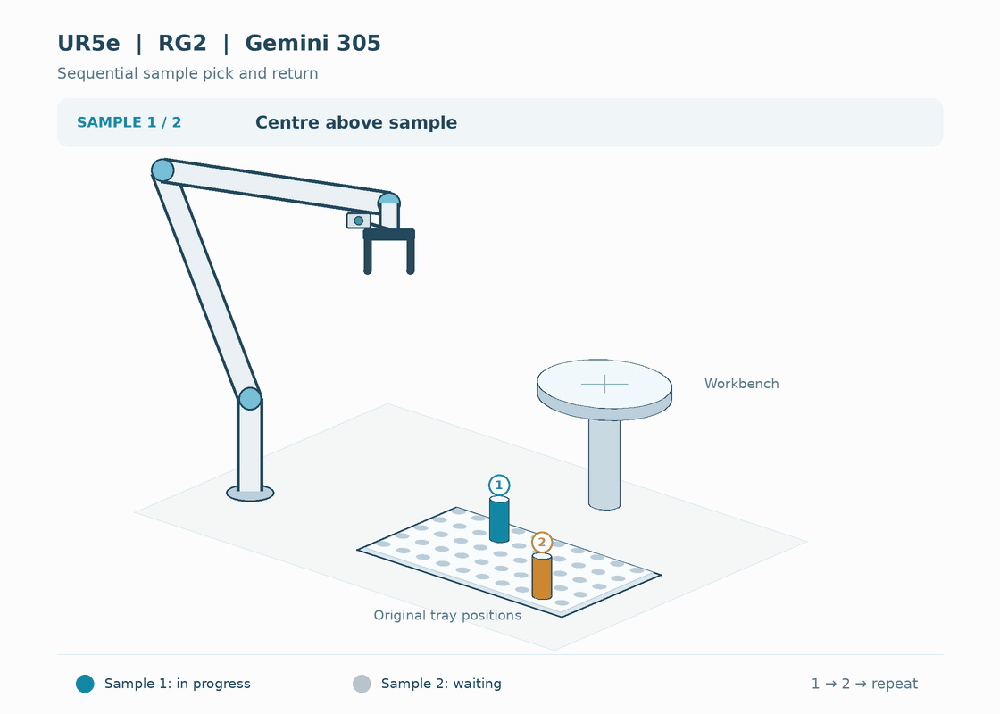
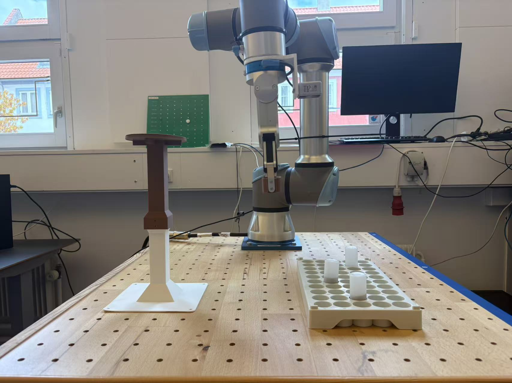
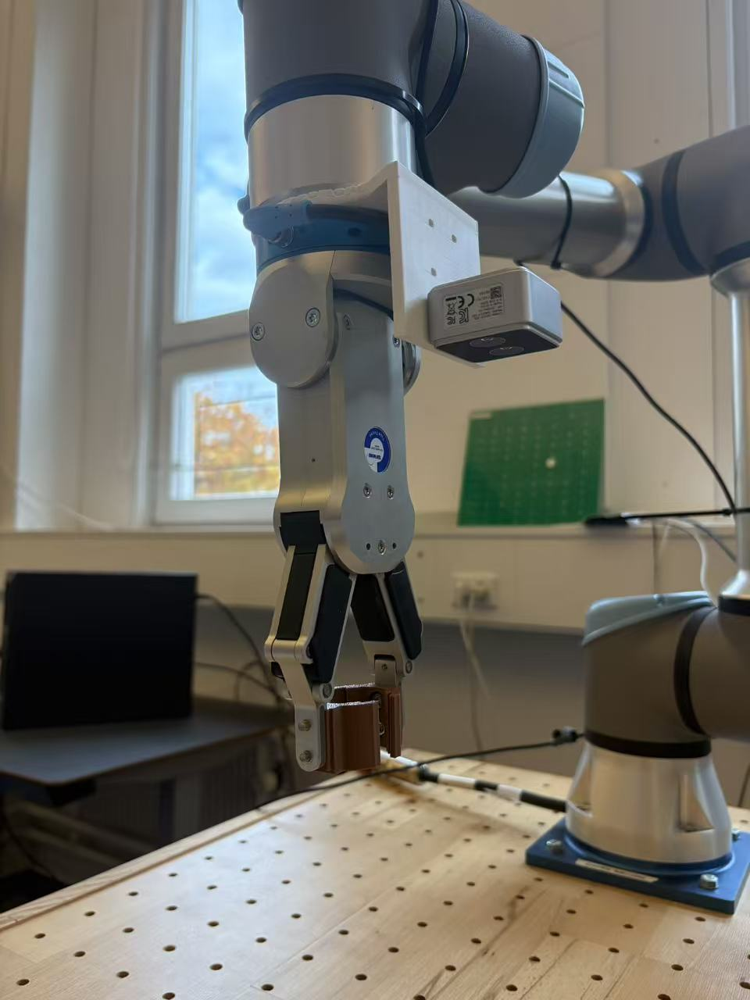
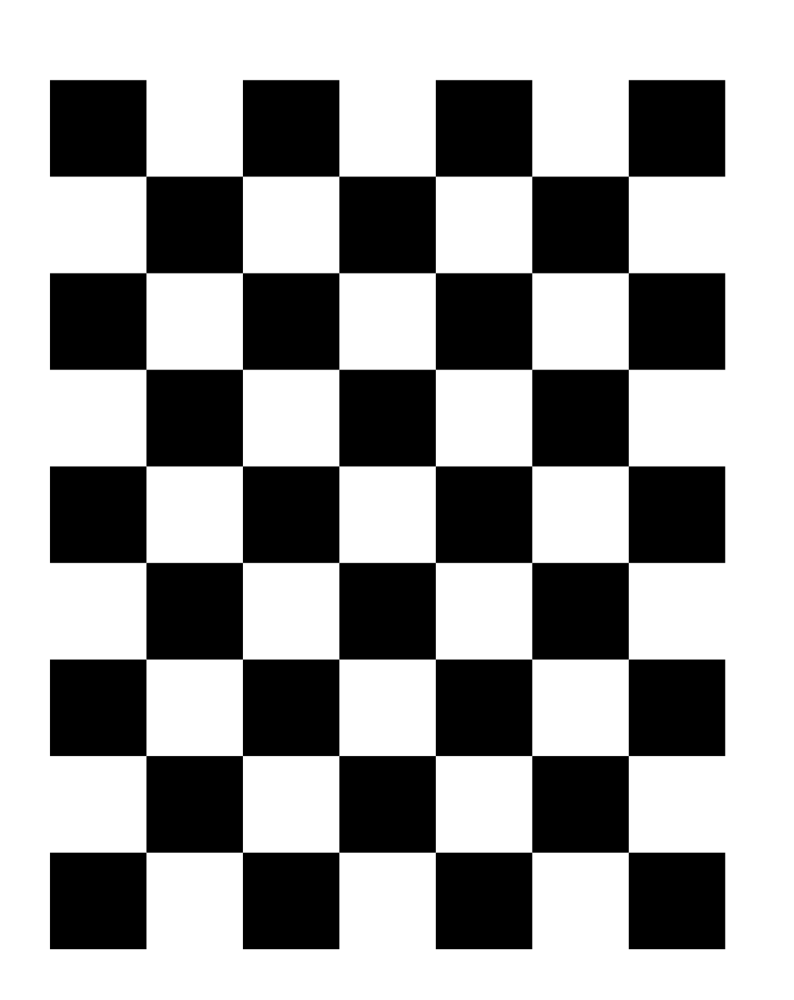
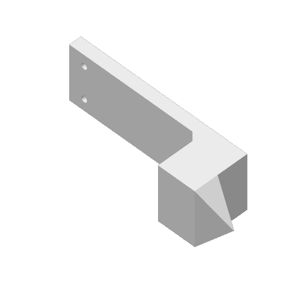
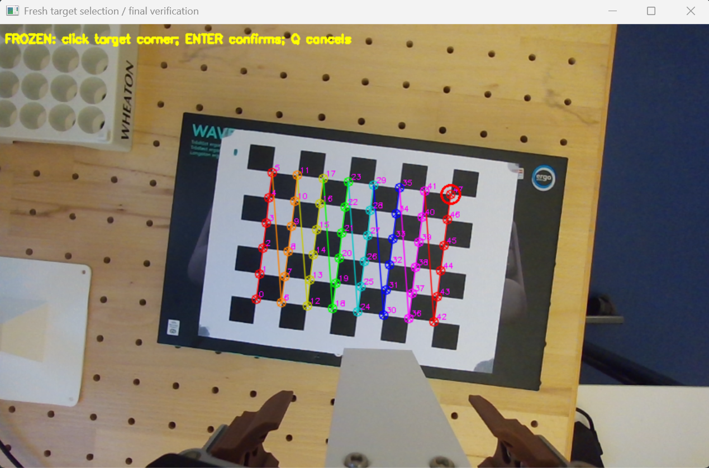
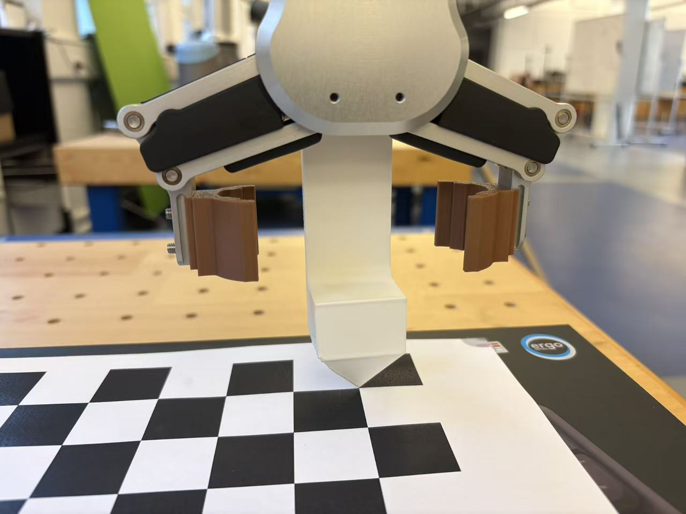
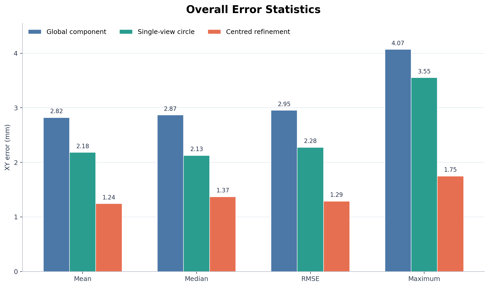
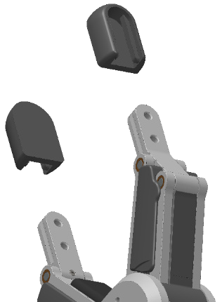
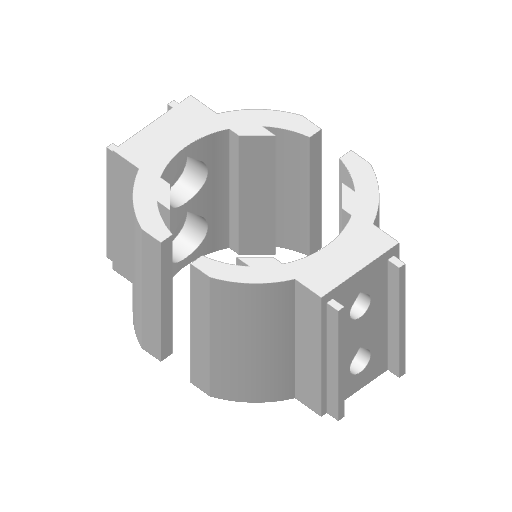

# UR5e Robotic Sample Handling for Geological Analysis

This project develops automated sample handling and positioning for geological-material testing in a laboratory.

Using a UR5e robotic arm, an Orbbec Gemini 305 RGB-D camera, and an OnRobot RG2 gripper, the system locates cylindrical samples in a tray, transfers them to an analysis workbench, and returns them to their original tray positions.

The application goal is to automate repetitive sample loading, positioning, and return, allowing researchers to focus on scientific measurements and interpretation. This repository provides the robotic handling module for integration with geological analysis equipment.

## Preview



## Hardware

- Universal Robots UR5e robotic arm
- Orbbec Gemini 305 RGB-D camera
- OnRobot RG2 gripper
- 3D-printed verification probe and custom gripper fingertips
- Calibration chessboard, sample tray, and workbench

## Experimental Setup

### System Overview



The experimental setup consists of the UR5e robotic arm, a wrist-mounted RGB-D camera, an RG2 gripper, a sample tray, and an elevated workbench. The tray holds the cylindrical samples, while the workbench provides the target surface for sample transfer.

### Camera and Gripper



The Gemini 305 camera is mounted near the robot wrist using a 3D-printed bracket, forming an eye-in-hand configuration. The RG2 gripper is fitted with custom 3D-printed fingertips for grasping cylindrical samples.

## Repository Structure

| Directory | Description |
| --- | --- |
| [Step 1 — Environment Setup and Warmup](step1_environment_setup_and_warmup/) | Keyboard control and initial robot setup. |
| [Step 2 — Hand–Eye Calibration](step2_handeye_calibration/) | Camera and robot checks, data collection, calibration, and validation. |
| [Step 3 — Hand–Eye Verification](step3_handeye_verification/) | Plane alignment, target selection, and point-touch testing. |
| [Step 4 — Sample Pick and Return](step4_sample_pick_and_return/) | Sample detection, workbench calibration, and pick-and-return cycles. |
| [Step 5 — Moving Workbench Follow](step5_moving_workbench_follow/) | Green workbench calibration and live XY following. |

The instructions below cover Steps 1–5.

## Software Environment

The project was developed on Windows. Use the Python environment tested with your Orbbec SDK build.

```powershell
python -m pip install numpy opencv-python ur-rtde pynput
```

Install the compatible Orbbec Python SDK separately. It must provide `pyorbbecsdk`.
Close Orbbec Viewer before running camera scripts.

Robot IP, camera serial number, calibration parameters, and tool geometry must match the actual setup. Run each stage separately, with robot motion supervised from the teach pendant.

## Step 1 — Environment Setup and Warmup

This script controls individual robot joints and triggers the existing RG2 programs.
The keys command joint rotation, rather than Cartesian X/Y/Z translation.

### Configuration and Run

Check these values in `step1_environment_setup_and_warmup/keyboard_control.py`:

| Setting | Included value |
| --- | --- |
| `ROBOT_IP` | `192.168.1.102` |
| `RG2_OPEN_PROGRAM` | `/programs/rg2_open_Li.urp` |
| `RG2_CLOSE_PROGRAM` | `/programs/rg2_close_Li.urp` |
| `JOINT_SPEED` | `0.04 rad/s` |

The two RG2 programs must already exist on the robot controller. The close action depends on the settings saved in that robot-side program.

From the repository root:

```powershell
python step1_environment_setup_and_warmup/keyboard_control.py
```

### Keyboard Controls

Hold **Space** and one joint key to move. Positive and negative directions refer to the robot's joint-angle convention.

| Joint | Positive rotation | Negative rotation |
| --- | --- | --- |
| J1 — Base | Space + Q | Space + A |
| J2 — Shoulder | Space + W | Space + S |
| J3 — Elbow | Space + E | Space + D |
| J4 — Wrist 1 | Space + R | Space + F |
| J5 — Wrist 2 | Space + T | Space + G |
| J6 — Wrist 3 | Space + Y | Space + H |

| Key or action | Behaviour |
| --- | --- |
| Space + O | Open the RG2 gripper. |
| Space + C | Run the configured RG2 close/grasp program. |
| Release a joint key | Stop that joint command. |
| Release Space | Clear all joint commands and command zero joint velocity. |
| Esc | Request a stop and exit the program. |

Only one joint key is accepted at a time. Holding multiple joint keys commands zero joint velocity.
Joint motion is disabled while an RG2 action is running. After the gripper action finishes and the RTDE control session is re-established, release Space and hold it again to resume joint control.

## Step 2 — Hand–Eye Calibration

The camera is mounted on the robot, while the chessboard remains fixed during calibration data collection.

### Calibration Board



| Parameter | Configuration |
| --- | --- |
| Board layout | 7 × 9 squares |
| Inner corners | 6 × 8, or 48 corners |
| `PATTERN` | `(6, 8)` |
| Square size used by the scripts | `25.5 mm` |
| `SQUARE_M` | `0.0255` |

The supplied PDF is a large-format source with approximately 108 mm squares at its original document size. Scale it when printing to obtain the required physical square size. A scale of approximately 23.61% corresponds to 25.5 mm squares; measure the printed result with a ruler.

Use the **measured printed square size** in both Step 2 and Step 3. The on-screen preview does not specify physical print dimensions. Mount the board on a flat, rigid support.

### Setup Checks

Set `ROBOT_IP`, `PATTERN`, and `SQUARE_M` in `step2_handeye_calibration/check_setup.py`, then run:

```powershell
python step2_handeye_calibration/check_setup.py
```

Run the checker again for each required option:

| Option | Purpose |
| --- | --- |
| 1 | Read camera intrinsics and save `gemini305_color_intrinsics.json`. |
| 2 | Preview the detected chessboard pose. |
| 3 | Check robot communication and read the actual TCP pose. |

### Collect Calibration Pairs

```powershell
python step2_handeye_calibration/collect_handeye_pair.py
```

Each execution saves one robot/camera pair in `step2_handeye_calibration/handeye_data/`.
Change the robot position and orientation between captures, then wait for it to stop. Keep the board, camera mounting, and active TCP configuration unchanged throughout collection. Select the same physical chessboard origin corner for each saved pair.

The current workflow uses 30 pairs:

- Samples 1–25: calibration.
- Samples 26–30: held-out validation.

### Solve and Validate

```powershell
python step2_handeye_calibration/solve_handeye.py
python step2_handeye_calibration/validate_handeye.py
```

| Output | Meaning |
| --- | --- |
| `T_tcp_camera.txt` | Transformation from camera coordinates into the active TCP frame. |
| `validation_result.txt` | Board-pose consistency results for the held-out pairs. |

The solver uses OpenCV's Park hand–eye method. Validation reports position and rotation consistency; it does not independently measure absolute robot positioning accuracy.

Calibration results are not automatically loaded by the touch-test script. Update its `H` matrix, camera intrinsics, distortion coefficients, and serial number to match the calibration used.

Step 3 expects a flange-referenced hand–eye transformation and zero active TCP. If Step 2 is collected with zero active TCP, `T_tcp_camera` is also `T_flange_camera`. Otherwise, convert it before use:

```text
T_flange_camera = T_flange_tcp × T_tcp_camera
```

Here, `T_A_B` maps coordinates from frame B into frame A; translation is in metres.

### Calibration Result

The estimated hand–eye transformation maps camera coordinates into the active TCP frame:

```text
T_tcp_camera =
[
    [-0.999792362, -0.017278033,  0.010802881,  0.010020657],
    [ 0.017295985, -0.999849180,  0.001570571,  0.074889656],
    [ 0.010774116,  0.001757091,  0.999940414,  0.058478193],
    [ 0.000000000,  0.000000000,  0.000000000,  1.000000000]
]
```

The coordinate transformation is:

```text
p_tcp = T_tcp_camera × p_camera
```

Points are expressed in homogeneous coordinates. The upper-left 3 × 3 block represents rotation; the last column represents translation in metres.

The translation vector is approximately `[10.021, 74.890, 58.478] mm`.

With zero active TCP during calibration, the TCP frame coincides with the flange frame, and this matrix is also `T_flange_camera`.

This result corresponds to the camera mounting used in this experiment. Recalibrate if the camera mounting changes. Positioning accuracy is evaluated separately through validation and physical touch tests.

## Step 3 — Hand–Eye Verification

This stage checks the combined camera, hand–eye, robot, and probe geometry by moving a mounted probe to a selected chessboard corner.

### Verification Probe



The attachment is a sliced Bambu Studio printing file. It contains the print instructions and a preview, rather than an editable STL mesh. The preview shows the supplied printed part; it does not show the complete mounted tool assembly.

### Probe Tip Offset and TCP

The current script uses the following nominal geometry:

| Parameter | Value |
| --- | --- |
| Controller active TCP during this test | Zero: `[0, 0, 0, 0, 0, 0]` |
| Probe tip relative to the zero-TCP/flange frame | `[0, 0, 245.6] mm` |
| Corresponding position vector in the script | `[0.0, 0.0, 0.2456] m` |

The **245.6 mm** value is the nominal distance along the local tool +Z axis from the zero-TCP origin to the physical tip after mounting. It is not the printed part's length alone and cannot be established from the printing file alone. Verify it on the installed assembly.

The script accounts for this offset when calculating the commanded pose:

```text
tip position in Base = TCP position in Base + TCP rotation × tip offset
commanded TCP position = target position in Base − TCP rotation × tip offset
```

Keep the controller's active TCP at zero for this script: the probe-tip offset is applied in the position calculation. Do not also enter 245.6 mm as the controller's active TCP offset.

The default probe length is set by the `--tip-z-mm` argument in `touch_target.py`. Running without arguments uses `245.6 mm`. Match it to the measured installed geometry before testing.

### Run

Check `IP`, `SERIAL`, `K`, `D`, `H`, the chessboard dimensions, and the probe geometry in `step3_handeye_verification/touch_target.py`.

With the probe installed and the board visible, run:

```powershell
python step3_handeye_verification/touch_target.py
```

The sequence is:

1. Capture the chessboard and estimate its plane.
2. Reposition the robot to obtain a perpendicular camera view.
3. Capture a new image and select the intended chessboard corner.
4. Complete the selection in the window; the script verifies the scene and moves the probe to the calculated target pose.
5. Stop at the target without an automatic withdrawal.

Session images, target information, motion plans, and execution records are saved under `step3_handeye_verification/handeye_touch_runs/`.

### Verification Demonstration

#### Target Selection



The camera detects the 48 inner corners of the chessboard. The selected target, corner #47 in this example, is highlighted with a red circle. Its position is transformed into the robot base frame using the estimated board pose and hand–eye transformation.

#### Probe Positioning



After target selection, the robot moves the mounted probe to the calculated target pose. The close-up shows the final probe-tip position relative to the chessboard corner.

This provides a qualitative check of the complete vision-to-robot positioning process. Numerical positioning accuracy is evaluated separately using measured tip-to-target errors.

#### Demonstration Video

[Download the original hand–eye verification video (MP4, 11.7 MB)](https://github.com/lijiawei0113-beep/ur5e-sample-pick-return/raw/refs/heads/main/assets/handeye_touch_test.mp4)

The original video shows the robot approaching the selected chessboard target with the mounted probe.

## Step 4 — Sample Pick and Return

This stage detects cylindrical samples in the tray, refines their centre positions, transfers them to the calibrated workbench centre, and returns them to their original tray points.

The gripper stays closed during the workbench dwell. The sample is not released and re-grasped at the workbench.

### Configuration

Install the grasping fingertips and check the following settings:

| File | Settings |
| --- | --- |
| `robot.py` | Robot IP, grasping TCP, payload, and basic motion parameters. |
| `vision.py` | Camera serial number, intrinsics, distortion coefficients, and `T_FLANGE_CAMERA`. |
| `pick_place_return.py` | Capture settings, grasp and placement heights, motion overrides, and RG2 communication. |

The probe geometry used in Step 3 and the grasping TCP used here describe different tool configurations. Match the settings to the installed hardware.

Update `T_FLANGE_CAMERA` using the hand–eye calibration for the current camera mounting. The matrix maps camera coordinates into the flange frame.

### RG2 Controller Program

This stage uses `/programs/rg2_command.urp` and its associated OnRobot installation on the robot controller.

The Python code sends commands through input integer register 18 and reads acknowledgements from output integer register 18:

| Action | Input command | In-progress ACK | Completion ACK |
| --- | --- | --- | --- |
| Open | 1 | 101 | 1 |
| Close | 2 | 102 | 2 |

Command 0 is idle. The completion acknowledgement must be written after the corresponding gripper action finishes.

The robot-side program and installation are not included in this repository.

### Calibrate the Workbench

Keep the empty workbench top and part of the supporting table visible. Close Orbbec Viewer, then run from the repository root:

```powershell
python step4_sample_pick_and_return/calibrate_workbench.py
```

This calibration reads RGB-D data without commanding robot motion.

Inspect the reported centre and the saved diagnostic image:

| Output | Description |
| --- | --- |
| `workbench_pose.json` | Workbench top centre and calibration information. |
| `workbench_nonfollow_place_result.png` | Detection and centre preview. |

The picking program reads this saved centre. Keep the workbench fixed during operation and recalibrate after moving it.

### Run Pick and Return

Prepare the samples in the tray, start with the workbench empty, and place the robot at the intended starting/Home pose. Enable Remote Control mode and close other robot-control programs.

```powershell
python step4_sample_pick_and_return/pick_place_return.py
```

Each cycle performs the following sequence:

1. Move to the tray overview pose and detect the current samples.
2. Centre the camera above a selected sample.
3. Capture fresh RGB-D frames and refine the sample centre.
4. Grasp the sample and transfer it to the workbench.
5. Hold it at the calibrated placement pose with the gripper closed.
6. Return it to its original tray point and open the gripper.
7. Continue with the remaining samples.

Direct execution repeats complete cycles continuously until stopped or interrupted by an error.

### Run Records

The program saves its outputs inside `step4_sample_pick_and_return/`:

| Output | Description |
| --- | --- |
| `all_samples_result.json` | Sample detections, planned poses, stages, and execution results. |
| `all_samples_result.png` | Tray overview with detected sample annotations. |
| `rtde_recovery_checkpoint.json` | Checkpoint information used by the recovery logic. |

The implementation includes bounded camera recovery and RTDE Receive reconnection. These mechanisms do not guarantee that every interruption can be recovered automatically.

### Demonstration Videos

- [Download one complete pick-and-return cycle (MP4)](https://github.com/lijiawei0113-beep/ur5e-sample-pick-return/releases/download/demo-v1/pick_return_one_cycle.mp4)
- [Download the extended-operation video at 60× speed (MP4)](https://github.com/lijiawei0113-beep/ur5e-sample-pick-return/releases/download/demo-v1/pick_return_60x.mp4)

The first video shows one complete sample-handling cycle. The second provides a 60× time-lapse view of extended operation.

## Step 5 — Moving Workbench Follow

This stage adds real-time XY following of a green workbench to the sample-handling sequence.

During following, the robot holds the sample above the workbench with fixed TCP height and orientation. After the workbench is judged stationary for 3 seconds, the program calculates the final centre, performs the workbench dwell, and returns the sample to the tray.

### Files and Dependencies

| File | Purpose |
| --- | --- |
| `calibrate_green_workbench.py` | Measure the green workbench centre and top height. |
| `pick_follow_return.py` | Pick samples, follow the workbench, dwell, and return samples. |

Step 5 imports `pick_place_return.py`, `vision.py`, and `robot.py` from Step 4.

Keep `step4_sample_pick_and_return` and `step5_moving_workbench_follow` beside each other with their existing names.

### Green Workbench Configuration

The supplied calibration is configured for:

| Parameter | Configuration |
| --- | --- |
| Nominal green top dimensions | 30 × 30 mm |
| Accepted height above the supporting table | 240–290 mm |
| Workbench motion during following | Horizontal XY translation |
| Top height during following | Fixed at the calibrated value |

Calibration uses `GREEN_HSV_LOWER` and `GREEN_HSV_UPPER` in `calibrate_green_workbench.py`.

Live tracking uses `GREEN_LOWER` and `GREEN_UPPER` in `pick_follow_return.py`. Adjust the relevant range if the green surface is not detected under the actual lighting.

### Calibrate the Green Workbench

Keep the empty green top and part of its supporting table visible, then run:

```powershell
python step5_moving_workbench_follow/calibrate_green_workbench.py
```

The program first detects the workbench. If the initial view is sufficient, it takes a fresh refinement without moving. Otherwise, it repositions the camera for a perpendicular view and retraces the planned path afterwards.

Inspect these outputs inside `step5_moving_workbench_follow/`:

| Output | Description |
| --- | --- |
| `workbench_pose.json` | Initial search centre and calibrated top height. |
| `workbench_calibration.png` | Green-top detection and centre preview. |

This calibration is saved separately from Step 4.

### Run Live Following

Prepare the tray samples and the robot starting pose, then run:

```powershell
python step5_moving_workbench_follow/pick_follow_return.py
```

No command-line arguments are required.

The sequence is:

1. Detect the tray samples and refine the selected sample centre.
2. Grasp the sample and move to the high observation pose.
3. Detect the green top and follow its horizontal motion.
4. Hold XY motion when the workbench is judged to have stopped.
5. Confirm a 3-second stability window and estimate the final centre.
6. Move to the workbench centre and dwell with the gripper closed.
7. Return the sample to its original tray point and open the gripper.
8. Process the remaining samples and return to the starting joint pose.

The follow stage uses a 60 mm lateral target-to-TCP offset to keep the held sample away from the camera's view of the green top.

The enlarged preview displays the target marker, XY error, follow state, and stability timer. Press **Esc** to stop the follow stage.

Unlike Step 4's continuous mode, Step 5 processes the detected samples once.

### Run Records

| Output | Description |
| --- | --- |
| `green_workbench_follow_run.json` | Sample-handling stages, follow results, and execution outcome. |
| `green_workbench_follow_latest.png` | Latest saved follow preview. |

These files are saved inside `step5_moving_workbench_follow/`.

### Demonstration Videos

- [Download the live-follow interface video (MP4)](https://github.com/lijiawei0113-beep/ur5e-sample-pick-return/releases/download/demo-v1/workbench_follow_interface.mp4)
- [Download the physical robot demonstration (MP4)](https://github.com/lijiawei0113-beep/ur5e-sample-pick-return/releases/download/demo-v1/workbench_follow_robot.mp4)

The interface video shows green-target detection, tracking information, and the stability timer during workbench movement.

The physical demonstration shows the UR5e operating with the movable green workbench during sample handling.

## Experiment 1 — Comparison of Three Centre-Estimation Methods

Three centre-estimation methods were compared at 15 selected tray holes.

Each position was measured 10 times. The statistics below were calculated across the 15 position-level mean XY errors.

### Methods

| Method | Centre estimation |
| --- | --- |
| Global connected-component centre | Use the coordinate-wise median of valid depth points in each detected component, expressed in Base XY. |
| Global single-frame circle fitting | Fit a circle using a single global-view frame, without repositioning the camera. |
| Centred refinement | Move the camera above the sample, capture fresh RGB-D data, and fit a robust circle to the local top-surface outline in Base XY. A bounds-based centre is used if the fit is unreliable. |

### Results

| Method | Valid positions | Mean (mm) | Median (mm) | RMSE (mm) | Maximum (mm) |
| --- | --- | --- | --- | --- | --- |
| Global connected-component centre | 15/15 | 2.820 | 2.867 | 2.952 | 4.069 |
| Global single-frame circle fitting | 11/15 | 2.182 | 2.126 | 2.275 | 3.551 |
| Centred refinement | 15/15 | **1.243** | **1.369** | **1.289** | **1.747** |



Centred refinement reduced the mean error by **55.9%** compared with global connected-component estimation and **43.0%** compared with global single-frame circle fitting.

It also reduced the side-minus-middle mean error gap from **0.935 mm** and **0.800 mm** to **0.243 mm**. The middle region covers columns 4–7; the side regions cover columns 1–3 and 8–10.

The results support the two-stage workflow: **global detection to locate samples, followed by centred refinement before grasping**.

## Experiment 2 — Original vs. Self-Centring Fingertips

This experiment compares the sample-placement error obtained with the original RG2 fingertips and custom self-centring fingertips.

The error is the XY distance between the sample centre and the workbench centre after placement.

### Fingertip Designs

| Original RG2 fingertips | Custom self-centring fingertips |
| :---: | :---: |
|  |  |

The custom fingertips guide the cylindrical sample towards the gripper centre during closing.

Original fingertip illustration: OnRobot RG2 datasheet, v1.8, page 5. Custom fingertip image: preview extracted from the supplied 3MF printing file.

### Results

Reported summary statistics for 100 placements per fingertip design:

| Metric | Original fingertips | Self-centring fingertips |
| --- | --- | --- |
| Mean error | 1.887 mm | **0.759 mm** |
| Median error | 1.762 mm | **0.707 mm** |
| Standard deviation | 0.709 mm | **0.383 mm** |
| Minimum–maximum | 0.640–3.202 mm | **0.100–1.900 mm** |
| Error ≤ 1 mm | 8/100 (8%) | **71/100 (71%)** |
| Error > 2 mm | 40/100 (40%) | **0/100 (0%)** |

The reported mean error and standard deviation were **59.8%** and **46.0%** lower, respectively, with the self-centring fingertips, indicating improved placement accuracy and consistency.

### Application Requirement

Using **XY placement error < 2 mm** as the project-specific acceptance criterion for the intended geological-sample testing station, the new fingertips achieved a maximum reported error of **1.900 mm**.

The reported results therefore meet this positioning criterion for the intended sample-testing workflow.
